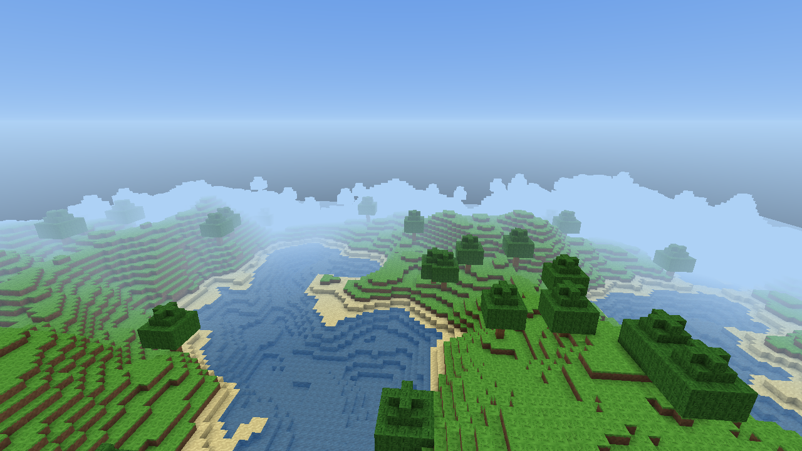
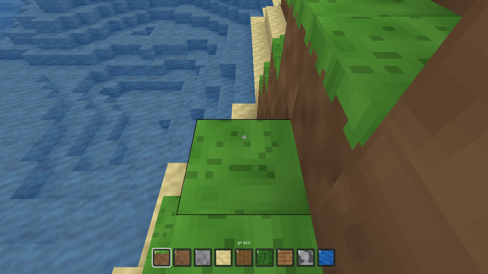
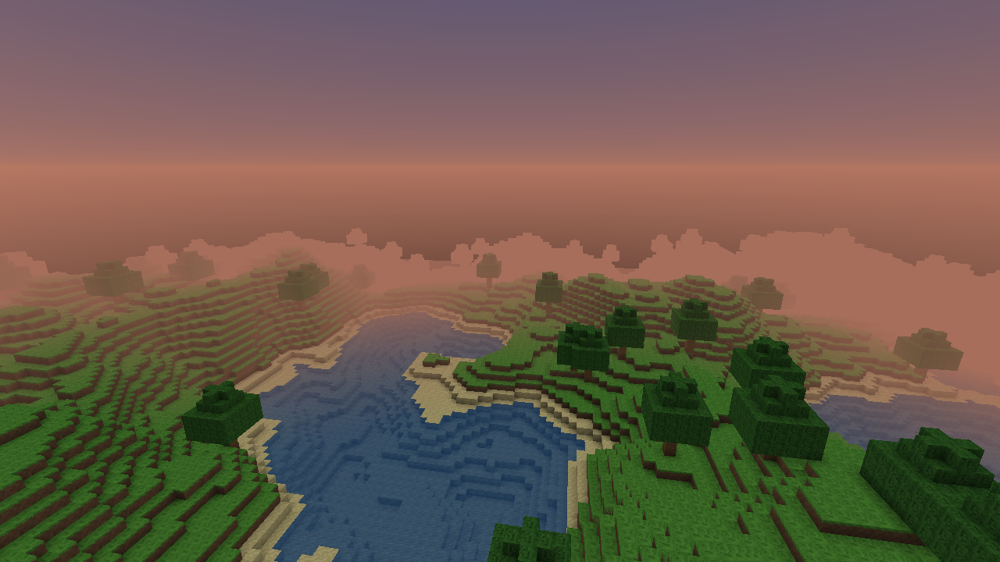
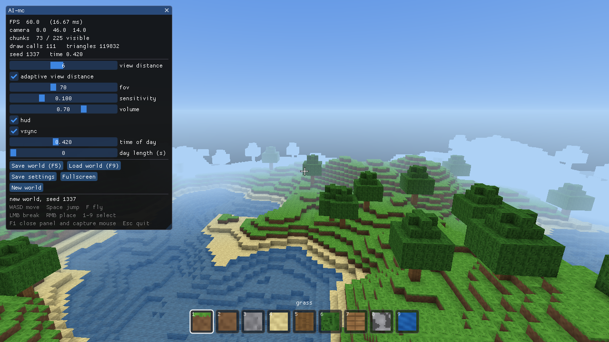
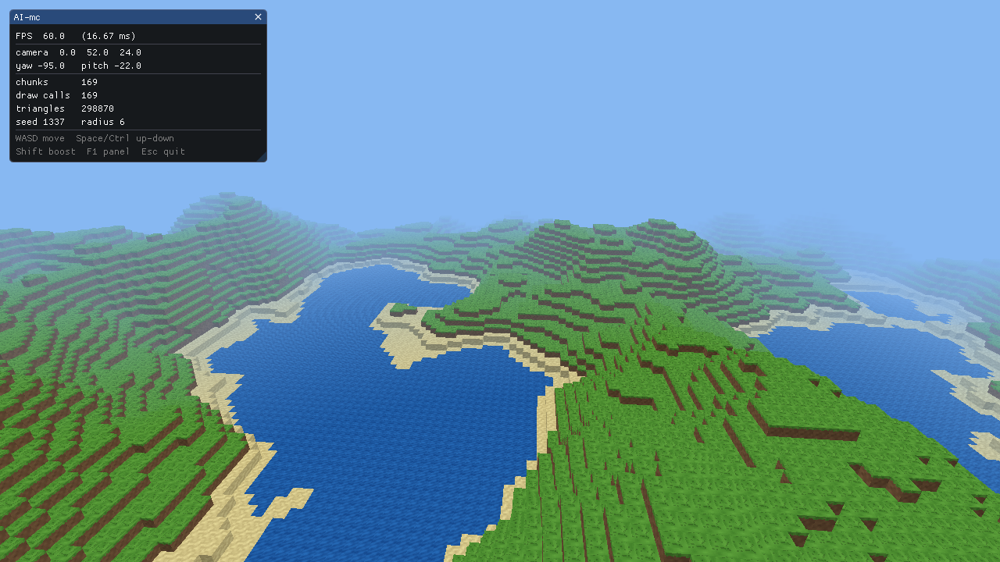

# AI-mc

> [!NOTE]
> 暂时停止开发。

> [!NOTE]
> 本项目由 **DeepSeek-V4.1-Flash** 模型与 **DeepSeek Harness** 智能体协作完成。
> Built with the **DeepSeek-V4.1-Flash** model and the **DeepSeek Harness** agent.

一个用 **C++20 + OpenGL 3.3** 从零搭的体素沙盒（Minecraft 风格），不依赖游戏引擎。
窗口/输入用 SDL2，调试面板用 Dear ImGui，地形用 FastNoiseLite，音频用 miniaudio，
存档压缩用 zlib。

**M0–M5 全部完成**：流式世界、多线程网格构建、玩家物理、破坏/放置、AO、昼夜、音效、
存档与设置面板。



## 功能

- **流式世界**：以玩家为中心动态加载/卸载 `16 x 64 x 16` 区块，无限水平延伸
- **后台线程**：TBB 并行地形生成与网格构建，主线程只负责 GL 上传（每帧预算 8 个）
- **渲染**：视锥剔除、距离雾、程序化 4×4 贴图集（带 padding + mipmap）、顶点 AO、
  半透明水面独立 pass、天空穹顶 + 太阳 + 星空
- **地形**：OpenSimplex2 + 4 层 fBm，海平面/沙滩/草地/水体，跨区块确定性树木
- **玩法**：AABB 玩家物理（重力/跳跃/游泳/创造飞行/双击 W 奔跑）、DDA 射线拾取、
  破坏/放置/取色、选中描边、9 格热键栏
- **时间**：昼夜循环、日落暖色、夜间星空与全局光照衰减
- **音频**：程序化合成的脚步/破坏/放置/跳跃/落地点击声（miniaudio 3D 无关，纯 2D 混音）
- **存档**：zlib 压缩的二进制格式，只保存玩家编辑 diff + 玩家状态，`F5`/`F9`/退出自动存档
- **设置**：视距、FOV、灵敏度、音量、昼夜长度、VSync、HUD、自适应视距

## 截图

| | |
|---|---|
|  **M3** 破坏/放置 · 选中描边 · 热键栏 |  **M4** 日落天空 |
|  **M5** 设置面板 + HUD |  **M1** 最早的原型 |

## 依赖

Arch Linux：

```bash
sudo pacman -S --needed pkgconf cmake ninja ccache gdb \
  sdl2 glew glm stb spdlog fmt nlohmann-json gtest \
  miniaudio zlib
```

Dear ImGui 与 FastNoiseLite 已 vendored 在 `third_party/`（可用 `scripts/fetch_thirdparty.sh` 重新下载）。

## 构建与运行

```bash
cmake -S . -B build -G Ninja
cmake --build build -j$(nproc)

./build/aimc                         # 默认 1280x720，打开设置面板
./build/aimc --view 8 --seed 42 --new
./build/aimc --benchmark 10 --no-vsync
./build/aimc --shot shot.png --hidden --width 1280 --height 720 --no-hud
```

控制：

| 按键 | 作用 |
|---|---|
| `WASD` | 移动（**双击 `W` 奔跑**） |
| `Space` / `Shift` | 跳跃、飞行上升 / 飞行加速 |
| `F` | 切换创造飞行 |
| 鼠标 | 视角 |
| 左键 / 右键 / 中键 | 破坏 / 放置 / 取色选块 |
| `1`–`9` / 滚轮 | 选择方块 |
| `F1` | 打开/关闭设置面板（打开时释放鼠标） |
| `F5` / `F9` | 快速存档 / 读档 |
| `M` | 静音 |
| `Esc` | 关闭面板；面板已关时退出 |

启动时如果存在 `save.aimc` 会自动读取；`--new` 或 `--seed` 会开新世界。

常用参数：

```
--view N / --radius N     视距（区块），会覆盖 settings.json
--seed N --new            新世界
--load PATH --save PATH   指定存档
--time T --day-length N   时间 0..1 / 一天秒数（0 冻结）
--benchmark N             跑 N 秒输出平均帧率
--shot PATH --hidden      无头截图
--no-vsync --no-hud --no-audio --verbose
```

## 测试

```bash
ctest --test-dir build --output-on-failure
```

19 个用例覆盖：区块索引、负数坐标除法、地形确定性与高度范围、树木生成、面剔除/AO 网格、
水独立缓冲、图集 UV、视锥剔除、DDA 射线、流式生成 + 方块编辑、存档与设置往返。

## 架构

```
src/audio      miniaudio 设备 + 程序化音效合成
src/core       数学工具 / 日志
src/game       Player（AABB 物理）、DDA 射线、Settings
src/platform   SDL2 窗口 / GL 上下文 / 全屏 / VSync
src/render     Atlas、ChunkMesh（AO）、Frustum、SelectionBox、Shader、Sky、Screenshot
src/ui         ImGui 调试面板 + HUD（准星/热键栏）
src/world      Block、Chunk、Terrain、World（流式 + 线程）、Save（zlib）
```

### 线程模型

- 区块状态机：`Empty → Generating → Generated → Meshing → Meshed → Ready`
- TBB `task_group` 在 worker 上生成地形和构建网格；结果进入 `concurrent_queue`
- 主线程每帧最多上传 8 个网格（GL 上下文单线程）
- 区块用 `shared_ptr` 持有，网格任务只读；玩家编辑用的 `shared_mutex` 保证数据安全
- 玩家编辑会 bump 版本号；过期的后台网格结果在 upload 时被丢弃并重新排队

### 存档格式

`AIMC` + version + seed + 玩家位置/朝向 + 时间 + 选中格 + 每区块编辑项，
整体用 zlib（`gzFile`）压缩。地形由 seed 确定性重建，因此只需保存差异。

## 性能

- 容器内是 **llvmpipe 软件渲染**：1280×720、视距 3 约 14 fps（天空全屏 shader 是主要开销）
- 你的 **Intel HD 620** 是真硬件加速，预计 1080p 60fps；用下面的命令实测：

```bash
./build/aimc --benchmark 10 --no-vsync
```

- 设置面板打开"adaptive view distance"后，帧时间 > 22ms 会自动降视距（最低 3），
  < 13ms 时回升（最高 10）

## 已知限制

- 单一生物群系，没有洞穴/矿脉/结构
- 水不流动、无水下折射/焦散
- 没有生物、合成、红石、方块光照传播（只有 AO + 天光近似）
- 存档只保存编辑；修改地形生成算法会让旧存档的地形变化
- 没有区块 LOD、间接绘制、阴影贴图

## 路线图

- [x] M0 窗口 + 主循环 + ImGui + 截图
- [x] M1 区块网格 + 程序化图集 + 自由相机 + 雾
- [x] M2 流式区块 + TBB 后台网格 + 视锥剔除 + 树 + mipmap + AO + 水面
- [x] M3 玩家物理 / 碰撞 / DDA / 破坏放置 / 高亮 / 热键栏
- [x] M4 天空昼夜 + 星空 + 程序化音效
- [x] M5 zlib 存档 + 设置面板 + 自适应视距
- [ ] 下一步候选：生物群系与洞穴、方块光照传播、LOD、彩色光照、存档版本迁移

## 许可证

本项目采用 **MIT License**，见 [LICENSE](LICENSE)。

`third_party/` 中的 Dear ImGui 与 FastNoiseLite 分别遵循其自带的 MIT 许可；
SDL2、GLEW、GLM、miniaudio、spdlog、zlib 等系统库遵循各自的许可证。
