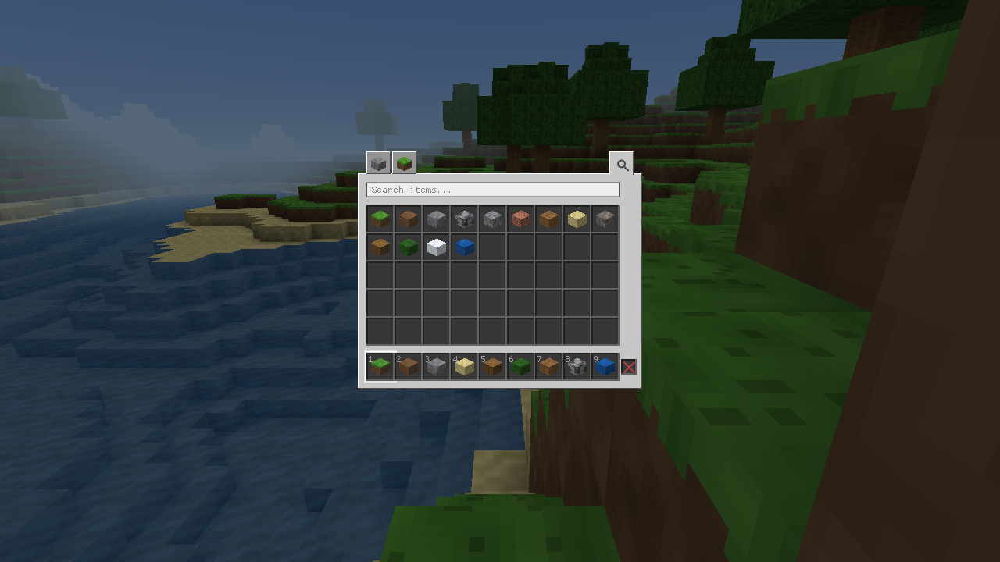
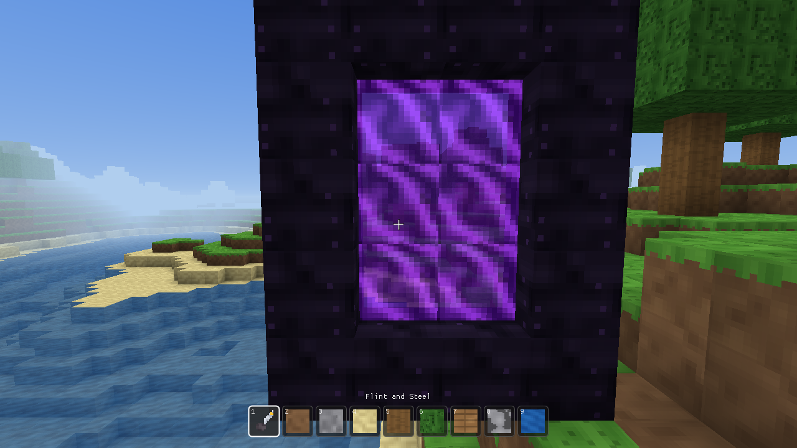
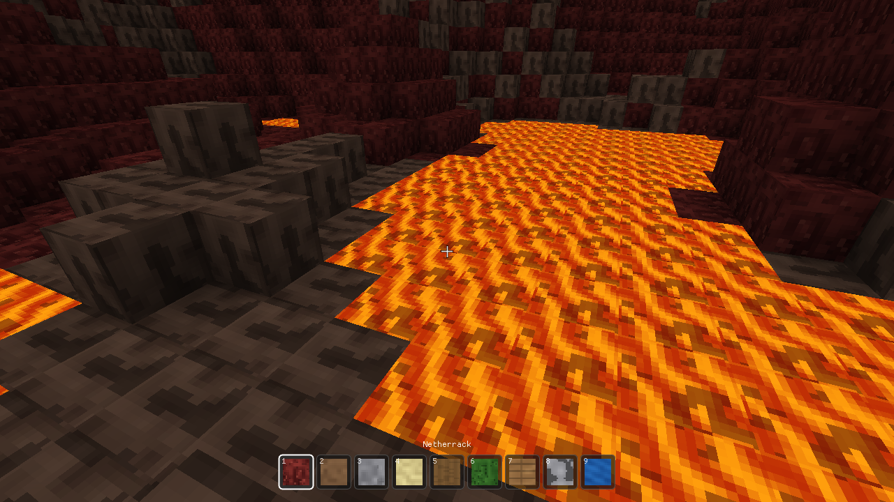

# 截图

> 返回 [README](../README.md)。

| | |
|---|---|
|  **M3** 破坏/放置 · 选中描边 · 热键栏 |  **M4** 日落天空 |
|  **M5** 设置面板 + HUD |  **M1** 最早的原型 |
|  **M6** 创造模式物品栏 · 分类 / 搜索 / 快捷栏 | |
|  **M7** 打火石点燃的黑曜石传送门 |  **M8** 地狱 · 熔岩海与地狱岩台地 |

主世界远景见 [m2.png](m2.png)。
